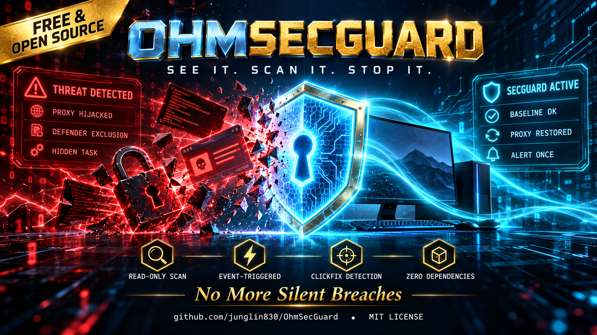

# OhmSecGuard（已併入 OhmShield 的「電腦」線）

> 本資料夾是 OhmShield 的 `pc/` 模組，原 [OhmSecGuard](https://github.com/junglin830/OhmSecGuard) 獨立倉庫已併入這裡維護。



**只看不改**的 Windows 個人電腦資安巡檢。零安裝依賴（Python 標準庫 + Windows 內建 PowerShell 5）。
專抓「一般防毒不會跳警告、但個人電腦最常中」的那幾招：**ClickFix 貼上指令、Defender 排除清單被加、隱藏排程、MITM 根憑證、hosts 劫持、Proxy 被改或指向已關閉的代理而整台斷網**。

> A read-only, zero-dependency Windows security & proxy watchdog for personal PCs. Monthly full scan + event-triggered quick checks (no polling). Detects ClickFix (Win+R paste), Defender exclusion tampering, hidden scheduled tasks (Tarrask), rogue root certificates, browser-policy proxies / force-installed extensions, hosts hijacking, dead-proxy network breakage, WMI persistence and suspicious VSS shadow-copy bursts. Baseline-diff based, notifies only when you need to act, never changes settings unless you explicitly run `fix`.

## 起源 (Why this exists)

這個工具來自一次真實的入侵處理經驗：一台個人電腦點了社群平台上的廣告，約 70 秒內就被植入竊密程式——網頁誘導執行指令（ClickFix 手法）、
建立偽裝成系統元件的排程、把 `powershell.exe` 和 `C:\Windows\System32` 加進 Defender 排除清單、寫入停用即時防護的群組原則、改寫 hosts、
每 1～2 天建一次磁碟陰影複製來讀取被鎖住的瀏覽器密碼。過程中 Defender 只在某一步跳過一次警告，之後就被繞過了。
清除之後，網路又因為設定被動過而整台斷線。

事後回頭看事件紀錄，**每一步都留下了痕跡**——只是沒有人去看。OhmSecGuard 就是那個「定期去看、有變化才叫你」的人。
用這套工具回放那次的事件紀錄，它會在惡意程式把自己加進排除清單的 20 秒內發出通知。
## 檢查什麼

| 類別 | 偵測 | 權限 |
|---|---|---|
| Proxy | 系統代理開著但指向的本機埠沒人在聽（→ 整台斷網）、指向外部主機、PAC 腳本、WinHTTP、環境變數、git/npm/pip 代理 | 一般 |
| 瀏覽器政策 | Chrome/Edge/Brave 被政策強制代理、強制安裝擴充功能 | 一般 |
| 根憑證 | CurrentUser / LocalMachine 受信任根憑證新增（中間人攻擊） | 一般 |
| ClickFix | Win+R（RunMRU）與檔案總管網址列被貼過 powershell/mshta/curl… 指令 | 一般 |
| Defender | 即時防護關閉、病毒碼過舊、近 35 天的設定變更事件（5007 排除清單）、威脅事件 | 一般 |
| hosts / DNS / 臨時埠 | hosts 被導到外部 IP、你封鎖過的惡意網域被解封、DNS 變更、動態埠範圍被縮小 | 一般 |
| 排程 / 開機啟動 | 新增項目（基準比對）＋可疑特徵（`-enc`、`iex`、下載、改 Defender、mshta…） | 一般 |
| 連線 | 單一行程 TCP 連線 ≥ 800 | 一般 |
| 隱藏排程 / WMI / 陰影複製 / Defender 排除清單 | Tarrask（SD 被刪）、WMI 事件訂閱常駐、近 35 天陰影複製 ≥ 4 | SYSTEM 輔助（選用） |

## 什麼時候跑

- **每月 1 號完整巡檢**（錯過會在開機後補跑）。
- **事件觸發快查（約 2–10 秒）**：網路重新連上、Defender 設定被改或抓到威脅時才跑。**不輪詢、平常零負擔。**
- 隨時手動：`python secguard.py scan --print`

## 安裝

```powershell
git clone https://github.com/junglin830/OhmShield
cd OhmShield\pc
cd OhmSecGuard
copy config.example.json config.json   # 選用：設定白名單、必須保持封鎖的網域、通知方式
python secguard.py scan --print        # 第一次會建立基準線
powershell -ExecutionPolicy Bypass -File install_tasks.ps1       # 每月 + 事件觸發
# 選用（系統管理員 PowerShell）：
powershell -ExecutionPolicy Bypass -File install_admin_ADMIN.ps1
python selftest.py                     # 在記憶體裡模擬 16 種攻擊，不改真設定
```

## 常用指令

| 指令 | 用途 |
|---|---|
| `python secguard.py accept proxy` | 剛才是你自己改的 → 接受為新基準（類別：proxy/winhttp/env_proxy/tool_proxy/hosts/dns/firewall/tasks/autostart/browser/rootcert/clickfix/defevents/all） |
| `python secguard.py fix disable_proxy` | 關閉系統代理（先備份到 `secguard_data\backups\`） |
| `python secguard.py fix restore_proxy` | 把代理還原成基準線 |
| `python secguard.py html` | 產生 `secguard_data\report.html` |

## 設計原則

1. **預設不改任何設定。** 唯一的修改是你親手下的 `fix`，且先備份。
2. **只在需要你動手時通知**；同一問題（內容指紋相同）只通知一次，問題消失後才會重新武裝。
3. **基準線比對**：變化可能是你自己做的，所以給你一鍵 `accept`，而不是一律當成攻擊。
4. **避開兩個 Windows 坑**：
   - 從某些 MSIX 封裝 App（例如桌面 AI App）底下執行時，HKCU / AppData / 憑證存放區會被虛擬化，讀到的是假的。偵測到就自動透過 WMI 跳出容器重跑。
   - 排程裡的 `pythonw` 直接用 `CREATE_NO_WINDOW` 叫 PowerShell 5 可能卡死在啟動；改由 `wscript` 隱藏啟動、結果寫檔。

## 授權

MIT
